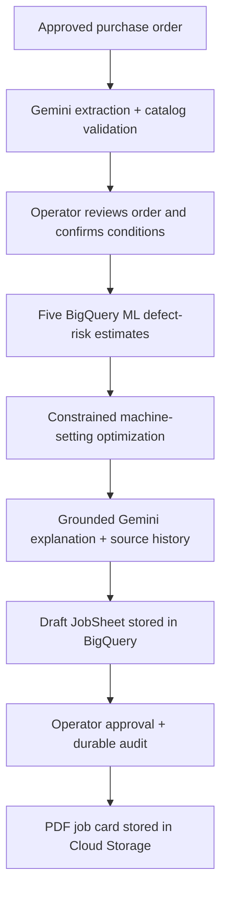
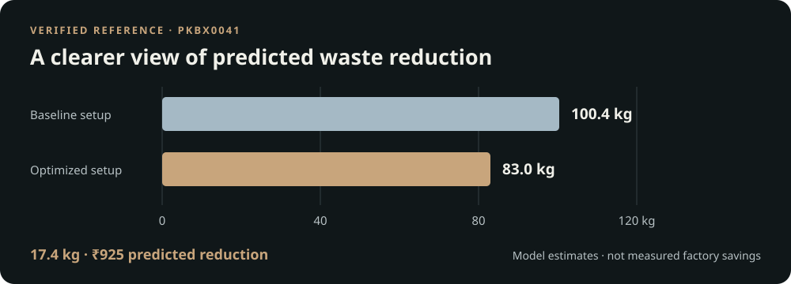

# Momentum

### Production intelligence for corrugated manufacturing

Turn an approved purchase order into a reviewed machine setup and an operator-approved production card. Momentum combines Gemini, manufacturing history and constrained optimization in one preparation workflow.

[Open the application](https://prepagent-26mwt2n7ba-el.a.run.app) · [Testing guide](docs/JUDGING_GUIDE.md) · [Release evidence](docs/RELEASE_PROVENANCE.md)

## From order to production card



Gemini reads and explains; validated tools and SQL perform prediction, optimization and persistence. An operator retains the approval decision. This is decision support, not autonomous machine control.

## A verified reference run



The approved **PKBX0041** reference case completed the genuine private Cloud Run PO-to-approved-card workflow on **16 October 2026**. Baseline predicted cost was **₹5,351**, versus **₹4,426** for the recommended setup. Independent BigQuery read-backs confirmed the draft and approval; the retrieved PDF matched its Cloud Storage object byte for byte. These figures are estimates for that case, not measured factory savings or a general performance guarantee. [Exact evidence and scope](docs/evidence/D4_LIVE_ACCEPTANCE_20261016.json).

## Explore the workspace

| Workspace | What it provides |
|---|---|
| **New Lot** | Approved PO intake, review, confirmed conditions, risk estimates, optimized settings, explanation, approval and stored card |
| **Defect Intelligence** | BigQuery historical cases, comparable operating-condition groups, detailed evidence and operator notes |
| **Photo Diagnosis** | Deliberate Gemini classification of the ten approved photos; selection itself makes no paid call |
| **Production Impact** | Held-out simulation estimates with source context; no annualized or measured-savings claim |

Use the [approved purchase orders and expected results](docs/JUDGING_GUIDE.md#approved-purchase-order-inputs) for testing. The hackathon uses temporary signed demo sessions: participants can approve their own TEST jobs, with that limitation disclosed. [Authorization policy](docs/HACKATHON_DEMO_AUTHORIZATION.md).

## Run locally

Requires **Node.js 22**, npm and authorized access to this repository.

```sh
git clone https://github.com/SiddhantOswal/UstaadAI---PrepAgent.git
cd UstaadAI---PrepAgent
npm ci
npm run preview:local
```

Open **http://localhost:4173**. This ordinary preview shows the current interface and honest empty states; it does not fabricate results or invoke paid cloud services. For the separately labeled offline backup, use `npm run demo:local`. Its mock outputs and in-memory records are not live-cloud evidence.

Cloning does not grant cloud permissions. The deployed app uses Cloud Run workload identity; a laptop needs its own authorized setup. See [local development](docs/LOCAL_DEVELOPMENT.md) for modes, environment configuration and maintainer checks. Existing `USTAAD_*` environment names, repository URL and GCP resource identifiers remain unchanged for compatibility.

## Cloud architecture and safeguards

**Cloud Run** hosts the application in `asia-south1`. **Vertex AI Gemini** handles extraction, explanations and photo classification. **BigQuery / BigQuery ML** supplies catalog/history, prediction, optimization and JobSheet persistence. **Cloud Storage** holds approved inputs and cards. **Firestore** provides the shared transactional Gemini attempt counter.

- Maximum **two Cloud Run instances** and **100 attempted Gemini calls per Asia/Kolkata day**; failed or ambiguous attempts count.
- Approved-input allowlists, request-size validation, TEST-only writes, session ownership and same-origin mutation checks.
- Explicit model-acceptance gate, human confirmation and durable approval auditing. Firebase remains a separate policy.
- Existing **₹5,000 budget alert**; an alert is not a hard spending cap.

## Prototype boundaries

- The real 117-item catalog underpins **modeled training/history**; conditions are simulated or manually entered. Factory accuracy and realized savings have not been established.
- Models are accepted under the documented supervised-prototype exception for unrecoverable original evaluation membership/counts. The supplementary September holdout is weaker; **CRACK has negative holdout R²** and is labeled low confidence in monsoon. [Model evidence](docs/d4/D4_MODEL_ACCEPTANCE_REPORT.md).
- PO review, coordination and trace state are process-local: an instance change can require extraction again. Saved approved jobs and cards remain durable. No cross-instance exactly-once guarantee is claimed.
- Historical photo classification matched **7 of 10** labels; this is not calibrated factory inspection accuracy. Completed-lot learning is outside the approved V1 scope.

[Documentation index](docs/README.md) · [PO-to-card acceptance procedure](docs/FINAL_PO_TO_CARD_ACCEPTANCE.md)
