# Momentum

**Production intelligence for corrugated manufacturing.** Momentum turns an approved purchase order into a reviewed setup recommendation and supervisor-approved production card, combining Gemini, BigQuery ML and constrained optimization.

[Open the application](https://prepagent-26mwt2n7ba-el.a.run.app) · [Local setup and testing](docs/README.md) · [Approved PO fixtures](public/samples/)

## How it works

```mermaid
flowchart LR
    A[Purchase order] --> B[Gemini extraction]
    B --> C[Catalog validation]
    C --> D[Operator confirms conditions]
    D --> E[Five defect-risk estimates]
    E --> F[Constrained setting optimization]
    F --> G[Grounded explanation]
    G --> H[Draft JobSheet]
    H --> I[Supervisor approval]
    I --> J[Stored PDF job card]
```



Gemini extracts and explains. Validated application tools and BigQuery perform catalog checks, prediction, optimization and persistence. A supervisor retains the approval decision; the system does not control machinery.

## Verified reference case

For PKBX0041, the recorded optimizer acceptance compared a **100.4 kg / ₹5,351** baseline with an **83.0 kg / ₹4,426** recommended result: **17.4 kg and ₹925 estimated reduction**. This is a model-based result for that evaluated case, not measured factory savings or a general performance guarantee. The private end-to-end acceptance also independently read back the JobSheet, approval audit and matching stored PDF.

## Product areas

| Area | Capability |
|---|---|
| **New Lot** | Approved PO intake, extraction review, confirmed conditions, risk estimates, optimized settings, explanation, approval and stored card |
| **Defect Intelligence** | BigQuery historical cases, comparable operating-condition groups, detailed evidence and operator notes |
| **Photo Diagnosis** | Gemini classification of the ten approved photos; selecting a photo does not itself make a provider call |
| **Production Impact** | Held-out simulation estimates with source context; no annualized or measured-savings claims |

## Run locally

Requires Node.js 22, npm and repository access.

```sh
git clone https://github.com/SiddhantOswal/UstaadAI---PrepAgent.git
cd UstaadAI---PrepAgent
npm ci
npm run preview:local
```

Open `http://localhost:4173`. The ordinary preview shows honest empty states and does not invoke paid cloud services. `npm run demo:local` starts a separate, clearly labeled offline mock backup; its output is not live-cloud evidence. Setup, testing, approved fixture details and current operating boundaries are in the [repository guide](docs/README.md).

## Cloud and safety

Cloud Run hosts the application in `asia-south1`. Vertex AI Gemini handles extraction, explanations and photo classification. BigQuery / BigQuery ML supports catalog/history, prediction, optimization and JobSheet persistence. Cloud Storage stores approved inputs and cards. Firestore provides the shared Gemini attempt counter.

- Cloud Run maximum: **2 instances**. Gemini limit: **100 attempted calls per Asia/Kolkata day**; failed or ambiguous attempts count.
- TEST-only writes, approved-input allowlists, request-size validation, session ownership and same-origin mutation checks.
- Model acceptance, operator confirmation and approval audit are enforced. Firebase remains separate from the selected Approach B workflow.
- The existing **₹5,000 budget alert** is an alert, not a hard spending cap.

## Scope and limitations

- The real 117-item catalog underpins modeled production history; conditions are simulated or manually entered. Factory accuracy and realized savings have not been established.
- Models are accepted for a supervised prototype under the documented exception for unrecoverable original evaluation membership/counts. The independent 219-lot September holdout is weaker; **CRACK has negative holdout R²** and is disclosed as low confidence in monsoon. Recommendations remain predicted estimates and require supervisor review.
- PO review, coordination and trace state are process-local; an instance change can require extraction again. Saved approved jobs and cards are durable; cross-instance exactly-once behavior is not claimed.
- Historical photo labels matched 7 of 10 approved images. This is not calibrated factory inspection accuracy. Completed-lot learning is outside approved V1 scope.
